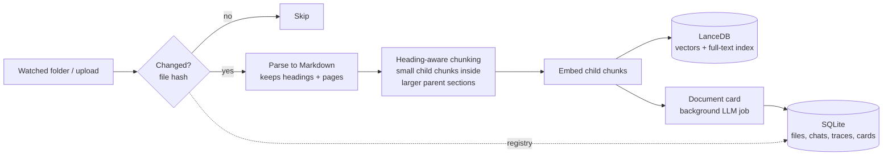
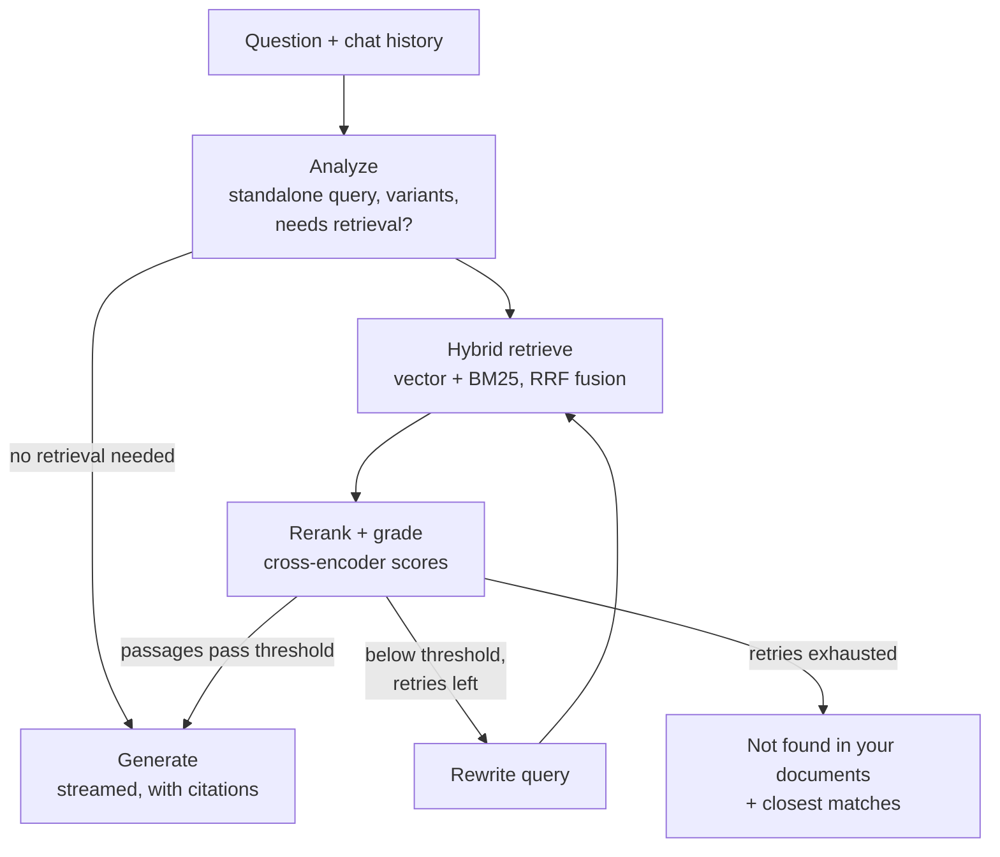
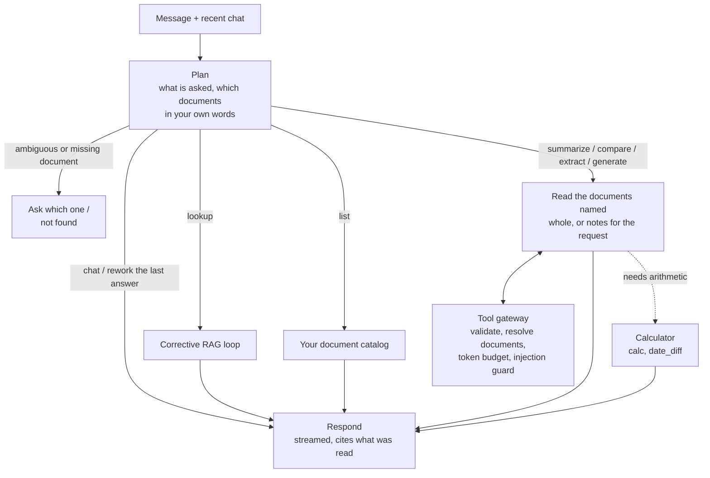

# VaultMind

**A fully local, privacy-first AI assistant for your own documents.**
Drop in PDFs, Markdown or text files and ask questions about them. VaultMind finds the relevant passages, checks that they actually answer the question, and answers with citations, or says the answer isn't in your documents. All of it runs on your own machine; nothing is sent to a cloud API.

> **Status: working prototype, measured end to end.** Ingestion (including Hebrew PDFs), hybrid retrieval with reranking, the corrective loop with an injection guard and a contradiction check, a document agent (list, summarize, compare, extract, calculate), traces, the evaluation harness, and the app (`vaultmind ui`) all run against real local models. Every number is in [RESULTS.md](docs/RESULTS.md), with a summary of what helped and what didn't. The main known gap: the planner adds ~2 s to every message ([known limitations](#known-limitations)). See [status](docs/STATUS.md) and the [execution plan](docs/EXECUTION_PLAN.md).

<!-- TODO(Phase 7): demo GIF here, showing the agent planning a task, reading documents step by step, and answering with citations -->

## Why

Most "chat with your documents" tools upload your files to someone else's servers. That rules them out for contracts, medical records, financial documents, research notes, or anything under NDA. VaultMind runs completely offline on consumer hardware:

- **Private.** Documents, embeddings, and conversations never leave your disk.
- **Free.** No API keys and no subscription.
- **Honest.** Every answer cites its sources. When the answer isn't in your documents, it says so instead of guessing.

## Features

- **Automatic ingestion.** Watches a folder (or accepts drag-and-drop) and parses, chunks, and indexes new or changed files incrementally.
- **Hybrid retrieval.** Combines semantic vector search with BM25 keyword search, so exact names, codes, and acronyms aren't missed.
- **Corrective RAG loop.** A cross-encoder reranker grades the retrieved passages. If none are good enough, the agent reports that the answer isn't in your documents and shows the closest matches, instead of guessing. Chat follow-ups are resolved into standalone questions. Query rewriting and query variants are available as switches; they are off by default because they didn't improve answers in our measurements ([results](docs/RESULTS.md)).
- **Prompt-injection guard.** Retrieved text goes to the model as quoted data, and passages containing instructions aimed at AI tools are flagged. When documents disagree, the answer states both claims with their sources.
- **Citations.** Each answer links to the file and page it came from.
- **Document tasks.** A planner call decides what each message asks for. Lookups take the corrective loop. "What documents do I have?" answers from your catalog. "Summarize X", "compare X and Y" and "extract ... as a table" read the documents named, whole when they fit the context window, otherwise as notes taken for the request, and cite the sections they read. Questions that need arithmetic or date counting get an exact calculator step first. Ambiguous requests ("summarize the lecture" with five lectures) get a clarifying question, and a document that doesn't exist gets "not found". Works in Hebrew and English.
- **Agent trace.** For every answer, see the queries that were tried, how each passage scored, and where the time went.
- **Built-in evaluation.** Every pipeline component can be toggled in config, and `vaultmind eval` measures what each one contributes.

## How it works

### Ingestion



### Answering a question

A planner call first decides what kind of request a message is (see [from search to document agent](#from-search-to-document-agent)). Lookups, the most common kind, go through the corrective loop:



The loop is a [LangGraph](https://github.com/langchain-ai/langgraph) state machine. Grading uses reranker scores rather than one LLM call per passage, which makes it faster and more reliable on local hardware. LLM calls are reserved for planning, query analysis, rewriting, document cards at ingest, the optional checks, and the answer. By default the analyze step runs only when there is chat history to resolve, and rewriting is off (it didn't help in the measurements).

### From search to document agent

At first every message was a lookup: search, keep the best passages, answer. That's why "summarize this document", "what documents do I have?" and "compare X with Y" failed in the first hand test. Phase 5.5 turned VaultMind into a local document agent. A planner decides what a message needs, and lookups keep the measured corrective loop. Document tasks read the documents you name.



- **What it knows about your files:** a card for each document, built at ingest (type, summary, outline, key dates), which gives the agent your catalog and lets "the Workato worksheet" resolve to a file. Cards aren't answer material: summaries built on them were too general, so the agent reads the documents themselves.
- **Tools:** plain local Python functions behind a validating gateway: list, outline, read, search one file, notes for a request, calculate, date difference. All read-only, and the agent has no delete tool.
- **What it measured:** on a 63-item task set (half Hebrew), task success went from 0.45 to 0.60, summaries from 3.3 to 7.0 of 10, while lookup quality held.
- **Decided against:** an open multi-step tool loop. After reading whole documents and adding the calculator, only 2 of 63 task items needed one ([plan](docs/EXECUTION_PLAN.md), Phase 5.5).

## Tech stack

| Layer | Choice | Why |
|---|---|---|
| Inference | [Ollama](https://ollama.com) | Local model daemon with a simple API and GPU acceleration |
| LLM | Qwen3 14B (Q4) | Strong reasoning and structured output that fits in 16 GB of VRAM |
| Embeddings | qwen3-embedding 0.6B | Small, fast, high retrieval quality |
| Reranker | bge-reranker-v2-m3 | Cross-encoder; more accurate relevance grading than an LLM, in milliseconds |
| Vector store | [LanceDB](https://lancedb.com) | Embedded and file-based, with built-in full-text search for hybrid retrieval |
| App state | SQLite | File registry, chat history, traces, document cards |
| Orchestration | LangGraph | Cyclic agent state, per-step event streaming |
| Parsing | pymupdf4llm | PDF to Markdown with heading structure and page numbers |
| UI | [NiceGUI](https://nicegui.io) (browser tab on 127.0.0.1; optional native window) | Event-driven Python UI, with no separate API layer. Browser mode by default: the native window's WebView2 contacts Microsoft by itself |

Models are configurable. Every model call goes through a small provider interface, so backends can be swapped and compared.

## Getting started

**Prerequisites:** [Ollama](https://ollama.com/download), [uv](https://docs.astral.sh/uv/), and a GPU. It's developed on an NVIDIA card with 16 GB of VRAM, where the LLM (~11 GB at the configured context), the embedder and the reranker all fit; with less VRAM, Ollama moves part of the model to the CPU and answers get slower. The `rerank` extra below installs a CUDA build of torch.

```bash
git clone https://github.com/Dima252/VaultMind.git
cd VaultMind

ollama pull qwen3:14b
ollama pull qwen3-embedding:0.6b

uv sync --extra rerank      # includes torch (CUDA 12.8 build) for the reranker
uv run vaultmind pull-reranker   # one-time download of bge-reranker-v2-m3 (~2.3 GB)
uv run vaultmind doctor     # checks Ollama and the models
```

After these setup steps nothing touches the network: the reranker is loaded from the local cache in offline mode. To skip the reranker (for example on a machine without an NVIDIA GPU), run plain `uv sync` and set `retrieval.rerank: false`.

Put your documents in `vault/` (PDF, Markdown, or text), then:

```bash
uv run vaultmind ingest                      # index new/changed files, forget deleted ones
uv run vaultmind ask "What does the contract say about termination?"
uv run vaultmind ask "What documents do I have?" --trace   # a document task; --trace shows the route and each step
```

Things to try, in English or Hebrew:

- "What documents do I have?" and "Which of my documents are about leases?"
- "Summarize the syllabus", then "make it shorter" or "translate it to English"
- "Compare the checklist with the worksheet"
- "Extract the parties, dates and governing law from the lease as a table"
- A question that needs arithmetic, such as the days between two dates in a document (uses the calculator)
- "What is the capital of Peru?" (not in your documents, so it says so)

Or use the app, which watches `vault/`, indexes changes as they happen and writes a document card for each file in the background:

```bash
uv run vaultmind ui          # opens in your browser on 127.0.0.1 (use --native for its own window)
uv run vaultmind enrich      # optional: write the missing document cards from the command line
```

## Configuration

All settings live in [`config/default.yaml`](config/default.yaml). To override them, copy the file to `config/local.yaml` (gitignored) or point `VAULTMIND_CONFIG` at another file. `uv run vaultmind config` prints the effective configuration.

## Evaluation

Current numbers (RTX 5070 Ti, `qwen3:14b`) on a 25-contract subset of [CUAD](https://www.atticusprojectai.org/cuad), a small adversarial set, and the author's own documents. Full ablations, per phase, are in [docs/RESULTS.md](docs/RESULTS.md):

| | Phase 2 baseline | Today |
|---|---:|---:|
| CUAD: gold clause in the top 5 passages | 0.708 | 0.854–0.958 |
| CUAD: answer correctness (LLM judge, ±5 points) | ~0.64 | ~0.80 |
| CUAD: abstention accuracy | ~0.75 | ~0.85 |
| Planted prompt injections resisted | 6/8 | 8/8 (40/40 in a targeted test) |
| Median time to a full answer (lookup) | 1.4 s | 1.5 s (3.5 s with the Phase 5.5 planner) |

What helped most was retrieval: hybrid search plus a cross-encoder reranker. The agent's query rewriting didn't help on these datasets, and the write-up says so. These are lookup numbers. Document tasks have their own eval (`vaultmind eval tasks`, 63 requests over the author's documents, half in Hebrew, graded on the key facts each answer should contain):

| Document tasks (3 runs each) | First version (M2) | Today |
|---|---:|---:|
| Task success | 0.45 | 0.60 |
| Share of expected facts in the answer | 0.53 | 0.69 |
| Summarize | 3.3/10 | 7.0/10 |
| Compare | 1.7/8 | 4.3/8 |
| Extract into a table | 2.0/8 | 4.7/8 |
| Questions that need a calculation | 5.7/15 | 6.3/15 |
| Planted instructions repeated in answers | 0 | 0 |

The biggest gain came from reading the documents themselves instead of their short summary cards. The weak spot is calculation questions the planner doesn't recognize as calculations.

The pipeline is measured against a test set of questions with known source passages, including questions whose answer is deliberately absent from the documents:

| Metric | What it measures |
|---|---|
| Recall@5 | Is the right passage among the five passed to the LLM? |
| MRR | How high does the right passage rank? |
| Answer correctness | Does the answer match the reference? |
| Abstention accuracy | When the answer isn't in the documents, does it say so? |
| Latency (p50 / p95) | What each component costs in time |

Each component (hybrid search, reranking, small-to-big retrieval, the rewrite loop) is measured with an ablation run so that its contribution is shown in numbers.

## Known limitations

- **The planner costs ~2 s per message.** Lookups take ~3.5 s at the median instead of 1.6 s without it (target: 2 s). A smaller planner model, or running retrieval while the planner decides, is the next thing to try.
- **Some calculations go unnoticed.** When the planner routes a question that needs arithmetic as a plain lookup, the calculator doesn't run (4 of 15 multi-step items).
- **Clarifying questions are a chat turn.** The agent asks and you answer in your next message. It doesn't pause a running task.
- **No scanned PDFs.** Files without a text layer aren't read (OCR is a later decision), and the PDF parser drops superscripts such as 2ⁿ.
- **One model, one GPU.** Developed and measured on a 16 GB NVIDIA card with `qwen3:14b`; with less VRAM, answers get slower.

## Development

```bash
uv run pytest          # unit tests (use fake models; no Ollama needed)
uv run pytest -m ollama  # integration tests: needs Ollama with the models, and the reranker
uv run ruff check . && uv run ruff format --check .
uv run mypy src tests
```

```
src/vaultmind/
  core/     config, shared types, model provider interfaces (Ollama, reranker)
  ingest/   parsers, chunker, pipeline, queue + folder watcher, document cards
  store/    LanceDB index; SQLite registry, chats, traces, document cards
  agent/    LangGraph graph and nodes, retrieval, injection guard, checks,
            planner, recipes, document catalog, tools, tool gateway
  app/      engine the UI runs on, export, citation highlighting, privacy check
  eval/     datasets, task set, metrics, judges, runners, CUAD importer
  ui/       NiceGUI interface
config/     YAML configuration
eval/       evaluation configs, datasets and fixtures (results stay local)
scripts/    parallel-agent workflow (worktrees, task prompts)
tests/      unit tests and fake providers
```

## Privacy

VaultMind makes network connections only to the local Ollama daemon (`127.0.0.1`). The one exception is downloading models on first setup. The app serves its UI on `127.0.0.1` only, refuses requests from other websites, and shows a live badge that checks its own connections. In browser mode (the default) the browser can see the page, so use a separate browser profile without extensions for it. A test that runs the full pipeline with all non-localhost connections blocked is planned for the hardening phase.

## License

MIT. The CUAD eval data is by Hendrycks et al. (NeurIPS 2021) and The Atticus Project, under CC BY 4.0.
