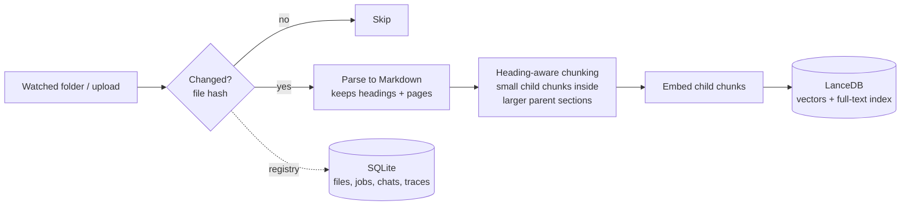
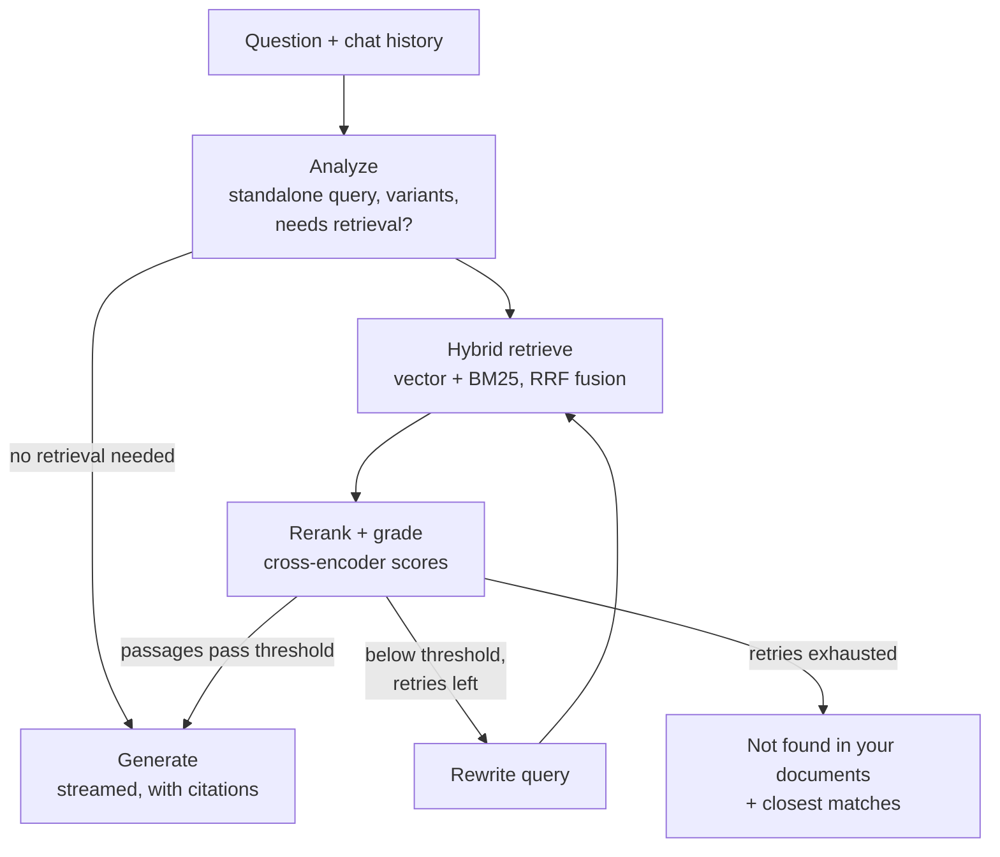

# VaultMind

**A fully local, privacy-first AI assistant for your own documents.**
Drop in PDFs, Markdown or text files and ask questions about them. VaultMind finds the relevant passages, checks that they actually answer the question, retries with a better search when they don't, and answers with citations, all on your own machine. Nothing is sent to a cloud API.

> 🚧 **Status: in development.** Ingestion and cited question answering work from the command line. The evaluation harness is next. See [status](docs/STATUS.md) and the [execution plan](docs/EXECUTION_PLAN.md). Evaluation results will be published here as each phase lands.

<!-- TODO(Phase 7): demo GIF here, showing the agent rejecting weak chunks, rewriting the query, and answering with citations -->

## Why

Most "chat with your documents" tools upload your files to someone else's servers. That rules them out for contracts, medical records, financial documents, research notes, or anything under NDA. VaultMind runs completely offline on consumer hardware:

- **Private.** Documents, embeddings, and conversations never leave your disk.
- **Free.** No API keys and no subscription.
- **Honest.** Every answer cites its sources. When the answer isn't in your documents, it says so instead of guessing.

## Features

- **Automatic ingestion.** Watches a folder (or accepts drag-and-drop) and parses, chunks, and indexes new or changed files incrementally.
- **Hybrid retrieval.** Combines semantic vector search with BM25 keyword search, so exact names, codes, and acronyms aren't missed.
- **Corrective RAG loop.** A cross-encoder reranker grades the retrieved passages. If none are good enough, the agent rewrites the query and searches again (bounded), or reports that the answer isn't in your documents.
- **Citations.** Each answer links to the file and page it came from.
- **Agent trace.** For every answer, see the queries that were tried, how each passage scored, and where the time went.
- **Built-in evaluation.** Every pipeline component can be toggled in config, and `vaultmind eval` measures what each one contributes.

## How it works

### Ingestion



### Answering a question



The loop is a [LangGraph](https://github.com/langchain-ai/langgraph) state machine. Grading uses reranker scores rather than one LLM call per passage, which makes it faster and more reliable on local hardware. LLM calls are reserved for query analysis, rewriting, and the final answer.

## Tech stack

| Layer | Choice | Why |
|---|---|---|
| Inference | [Ollama](https://ollama.com) | Local model daemon with a simple API and GPU acceleration |
| LLM | Qwen3 14B (Q4) | Strong reasoning and structured output that fits in 16 GB of VRAM |
| Embeddings | qwen3-embedding 0.6B | Small, fast, high retrieval quality |
| Reranker | bge-reranker-v2-m3 | Cross-encoder; more accurate relevance grading than an LLM, in milliseconds |
| Vector store | [LanceDB](https://lancedb.com) | Embedded and file-based, with built-in full-text search for hybrid retrieval |
| App state | SQLite | File registry, ingestion jobs, chat history, traces |
| Orchestration | LangGraph | Cyclic agent state, per-step event streaming |
| Parsing | pymupdf4llm | PDF to Markdown with heading structure and page numbers |
| UI | [NiceGUI](https://nicegui.io) (native window) | Event-driven Python UI in a real desktop window, with no separate API layer |

Models are configurable. Every model call goes through a small provider interface, so backends can be swapped and compared.

## Getting started

**Prerequisites:** [Ollama](https://ollama.com/download), [uv](https://docs.astral.sh/uv/), and a GPU with 12 GB+ of VRAM recommended (it also runs on CPU, but slowly).

```bash
git clone https://github.com/Dima252/VaultMind.git
cd VaultMind

ollama pull qwen3:14b
ollama pull qwen3-embedding:0.6b

uv sync
uv run vaultmind doctor     # checks Ollama and the models
```

Put your documents in `vault/` (PDF, Markdown, or text), then:

```bash
uv run vaultmind ingest                      # index new/changed files, forget deleted ones
uv run vaultmind ask "What does the contract say about termination?"
```

<!-- TODO(Phase 5): `uv run vaultmind ui` -->

## Configuration

All settings live in [`config/default.yaml`](config/default.yaml). To override them, copy the file to `config/local.yaml` (gitignored) or point `VAULTMIND_CONFIG` at another file. `uv run vaultmind config` prints the effective configuration.

## Evaluation

<!-- TODO(Phase 2+): results table -->

The pipeline is measured against a test set of questions with known source passages, including questions whose answer is deliberately absent from the documents:

| Metric | What it measures |
|---|---|
| Recall@5 | Is the right passage among the five passed to the LLM? |
| MRR | How high does the right passage rank? |
| Answer correctness | Does the answer match the reference? |
| Abstention accuracy | When the answer isn't in the documents, does it say so? |
| Latency (p50 / p95) | What each component costs in time |

Each component (hybrid search, reranking, small-to-big retrieval, the rewrite loop) is measured with an ablation run so that its contribution is shown in numbers.

## Development

```bash
uv run pytest          # unit tests (use fake models; no Ollama needed)
uv run pytest -m ollama  # integration tests against a running Ollama
uv run ruff check . && uv run ruff format --check .
uv run mypy src tests
```

```
src/vaultmind/
  core/     config, model provider interfaces
  ingest/   folder watcher, parsers, chunker, pipeline
  store/    LanceDB index, SQLite registry
  agent/    LangGraph nodes and graph
  eval/     datasets, metrics, runner
  ui/       NiceGUI interface
config/     YAML configuration
eval/       evaluation datasets and results
tests/      unit tests and fake providers
```

## Privacy

VaultMind makes network connections only to the local Ollama daemon (`127.0.0.1`). The one exception is downloading models on first setup. A test suite runs the full pipeline with all non-localhost connections blocked to keep this guarantee true.

## License

MIT
