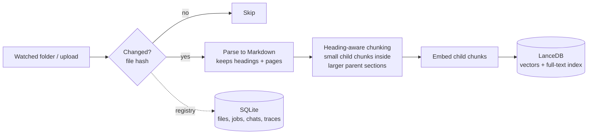
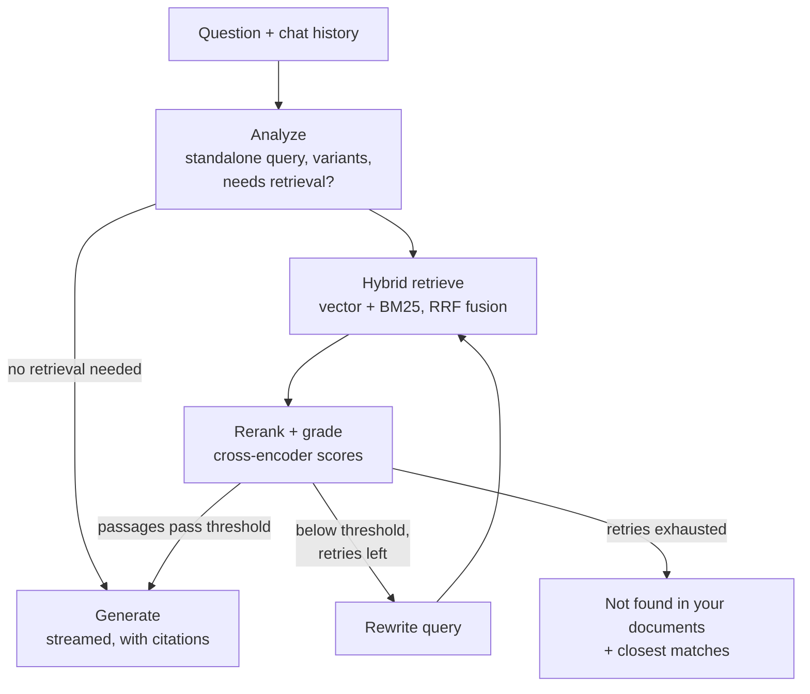
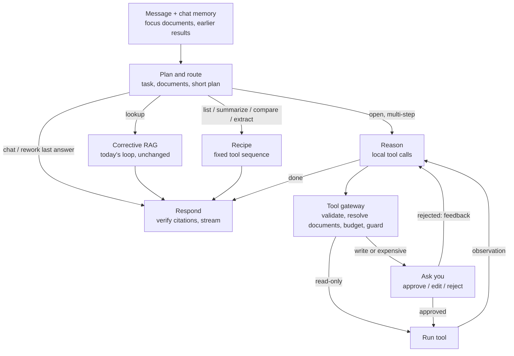

# VaultMind

**A fully local, privacy-first AI assistant for your own documents.**
Drop in PDFs, Markdown or text files and ask questions about them. VaultMind finds the relevant passages, checks that they actually answer the question, retries with a better search when they don't, and answers with citations, all on your own machine. Nothing is sent to a cloud API.

> 🚧 **Status: in development.** Working today: ingestion (including Hebrew PDFs), hybrid retrieval with reranking, the corrective loop with an injection guard and a contradiction check, traces, the evaluation harness, and the app (`vaultmind ui`). It answers lookup questions well, but can't yet summarize, list, compare or plan multi-step work. Turning it into a full document agent is the next phase ([roadmap](#roadmap-from-search-to-document-agent)). See [status](docs/STATUS.md), [results](docs/RESULTS.md) and the [execution plan](docs/EXECUTION_PLAN.md).

<!-- TODO(Phase 7): demo GIF here, showing the agent planning a task, reading documents step by step, and answering with citations -->

## Why

Most "chat with your documents" tools upload your files to someone else's servers. That rules them out for contracts, medical records, financial documents, research notes, or anything under NDA. VaultMind runs completely offline on consumer hardware:

- **Private.** Documents, embeddings, and conversations never leave your disk.
- **Free.** No API keys and no subscription.
- **Honest.** Every answer cites its sources. When the answer isn't in your documents, it says so instead of guessing.

## Features

- **Automatic ingestion.** Watches a folder (or accepts drag-and-drop) and parses, chunks, and indexes new or changed files incrementally.
- **Hybrid retrieval.** Combines semantic vector search with BM25 keyword search, so exact names, codes, and acronyms aren't missed.
- **Corrective RAG loop.** A cross-encoder reranker grades the retrieved passages. If none are good enough, the agent reports that the answer isn't in your documents and shows the closest matches, instead of guessing. Chat follow-ups are resolved into standalone questions. Query rewriting and query variants are available as switches; they are off by default because they didn't improve answers in our measurements ([results](docs/RESULTS.md)).
- **Prompt-injection guard.** Retrieved text goes to the model as quoted data, and passages containing instructions aimed at AI tools are flagged. When documents disagree, the answer states both claims with their sources.
- **Citations.** Each answer links to the file and page it came from.
- **Agent trace.** For every answer, see the queries that were tried, how each passage scored, and where the time went.
- **Built-in evaluation.** Every pipeline component can be toggled in config, and `vaultmind eval` measures what each one contributes.

## How it works

### Ingestion



### Answering a question



The loop is a [LangGraph](https://github.com/langchain-ai/langgraph) state machine. Grading uses reranker scores rather than one LLM call per passage, which makes it faster and more reliable on local hardware. LLM calls are reserved for query analysis, rewriting, and the final answer.

### Roadmap: from search to document agent

Today every message is a lookup: search, keep the best passages, answer. That's why "summarize this document", "what documents do I have?" and "compare X with Y" fail. The next phase turns VaultMind into a local document agent: a ReAct loop with human-in-the-loop, behind fast paths so simple questions stay fast.



- **Document cards** written at ingest (type, summary, outline, key dates and entities), so the agent knows your library and can work with whole documents within a local context window.
- **Local tools**: list documents, outline, read pages or sections, search one file, summarize, extract into a table, calculate. All plain Python over the local index. Writes need your approval, and the agent has no delete tool.
- **It asks instead of guessing** when a request is ambiguous ("which syllabus?") or a job is long.
- **Measured** like everything else: a new task eval set (half Hebrew), with lookup quality and latency held where they are today.

Details and milestones: [execution plan, Phase 5.5](docs/EXECUTION_PLAN.md).

## Tech stack

| Layer | Choice | Why |
|---|---|---|
| Inference | [Ollama](https://ollama.com) | Local model daemon with a simple API and GPU acceleration |
| LLM | Qwen3 14B (Q4) | Strong reasoning and structured output that fits in 16 GB of VRAM |
| Embeddings | qwen3-embedding 0.6B | Small, fast, high retrieval quality |
| Reranker | bge-reranker-v2-m3 | Cross-encoder; more accurate relevance grading than an LLM, in milliseconds |
| Vector store | [LanceDB](https://lancedb.com) | Embedded and file-based, with built-in full-text search for hybrid retrieval |
| App state | SQLite | File registry, ingestion jobs, chat history, traces |
| Orchestration | LangGraph | Cyclic agent state, per-step event streaming |
| Parsing | pymupdf4llm | PDF to Markdown with heading structure and page numbers |
| UI | [NiceGUI](https://nicegui.io) (browser tab on 127.0.0.1; optional native window) | Event-driven Python UI, with no separate API layer. Browser mode by default: the native window's WebView2 contacts Microsoft by itself |

Models are configurable. Every model call goes through a small provider interface, so backends can be swapped and compared.

## Getting started

**Prerequisites:** [Ollama](https://ollama.com/download), [uv](https://docs.astral.sh/uv/), and a GPU with 12 GB+ of VRAM recommended (it also runs on CPU, but slowly).

```bash
git clone https://github.com/Dima252/VaultMind.git
cd VaultMind

ollama pull qwen3:14b
ollama pull qwen3-embedding:0.6b

uv sync --extra rerank      # includes torch (CUDA 12.8 build) for the reranker
uv run vaultmind pull-reranker   # one-time download of bge-reranker-v2-m3 (~2.3 GB)
uv run vaultmind doctor     # checks Ollama and the models
```

After these setup steps nothing touches the network: the reranker is loaded from the local cache in offline mode. To skip the reranker, run plain `uv sync` and set `retrieval.rerank: false`.

Put your documents in `vault/` (PDF, Markdown, or text), then:

```bash
uv run vaultmind ingest                      # index new/changed files, forget deleted ones
uv run vaultmind ask "What does the contract say about termination?"
```

Or use the app, which watches `vault/` and indexes changes as they happen:

```bash
uv run vaultmind ui          # opens in your browser on 127.0.0.1 (use --native for its own window)
```

## Configuration

All settings live in [`config/default.yaml`](config/default.yaml). To override them, copy the file to `config/local.yaml` (gitignored) or point `VAULTMIND_CONFIG` at another file. `uv run vaultmind config` prints the effective configuration.

## Evaluation

Current numbers (RTX 5070 Ti, `qwen3:14b`). Full ablations, per phase, are in [docs/RESULTS.md](docs/RESULTS.md):

| | Phase 2 baseline | Today |
|---|---:|---:|
| CUAD: gold clause in the top 5 passages | 0.708 | 0.854–0.958 |
| CUAD: answer correctness (LLM judge, ±5 points) | ~0.64 | ~0.80 |
| CUAD: abstention accuracy | ~0.75 | ~0.85 |
| Planted prompt injections resisted | 6/8 | 8/8 (40/40 in a targeted test) |
| Median time to a full answer | 1.4 s | 1.5 s |

What helped most was retrieval: hybrid search plus a cross-encoder reranker. The agent's query rewriting didn't help on these datasets, and the write-up says so.

The pipeline is measured against a test set of questions with known source passages, including questions whose answer is deliberately absent from the documents:

| Metric | What it measures |
|---|---|
| Recall@5 | Is the right passage among the five passed to the LLM? |
| MRR | How high does the right passage rank? |
| Answer correctness | Does the answer match the reference? |
| Abstention accuracy | When the answer isn't in the documents, does it say so? |
| Latency (p50 / p95) | What each component costs in time |

Each component (hybrid search, reranking, small-to-big retrieval, the rewrite loop) is measured with an ablation run so that its contribution is shown in numbers.

## Development

```bash
uv run pytest          # unit tests (use fake models; no Ollama needed)
uv run pytest -m ollama  # integration tests against a running Ollama
uv run ruff check . && uv run ruff format --check .
uv run mypy src tests
```

```
src/vaultmind/
  core/     config, model provider interfaces
  ingest/   folder watcher, parsers, chunker, pipeline
  store/    LanceDB index, SQLite registry
  agent/    LangGraph nodes and graph
  eval/     datasets, metrics, runner
  ui/       NiceGUI interface
config/     YAML configuration
eval/       evaluation datasets and results
tests/      unit tests and fake providers
```

## Privacy

VaultMind makes network connections only to the local Ollama daemon (`127.0.0.1`). The one exception is downloading models on first setup. The app serves its UI on `127.0.0.1` only, refuses requests from other websites, and shows a live badge that checks its own connections. A test that runs the full pipeline with all non-localhost connections blocked is planned for the hardening phase.

## License

MIT
